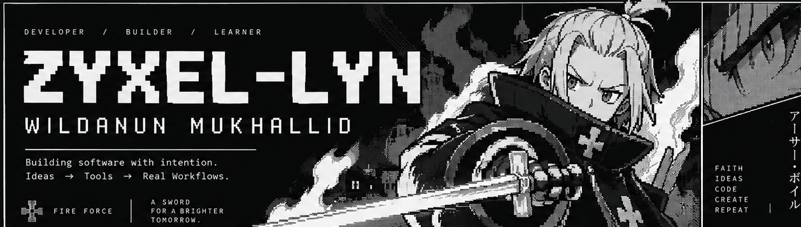
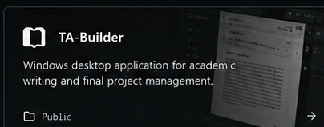
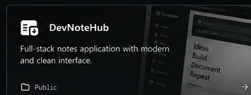
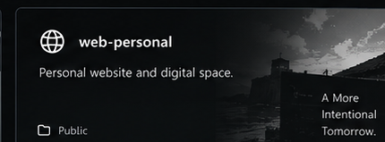
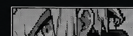

<!--
ZYXEL-LYN / GitHub profile README
Visual canon: V2 Monochrome — Arthur Boyle Pixel / manga panels.
Static native GitHub README: no custom CSS, JS, simulated controls, or fictitious metrics.
-->

  

 

### `01 / SELECTED WORK`

<table>
  <tr>
    <td width="33.33%" valign="top">
      
      
<strong><a href="https://github.com/zyxel-lyn/TA-Builder">TA-Builder</a></strong> 
      Windows desktop workspace for structured academic writing, from proposals to final reports.

    </td>
    <td width="33.33%" valign="top">
      
      
<strong><a href="https://github.com/zyxel-lyn/devnotehub">DevNoteHub</a></strong> 
      Full-stack notes application with authentication, search, tags, and personal organization.

    </td>
    <td width="33.33%" valign="top">
      
      
<strong><a href="https://github.com/zyxel-lyn/web-personal">web-personal</a></strong> 
      A personal website for selected work, background, and contact.

    </td>
  </tr>
</table>

<table>
  <tr>
    <td width="46%" valign="top">
      <strong><code>02 / ABOUT</code></strong>
      
I'm <strong>Wildanun Mukhallid</strong> (<code>zyxel-lyn</code>), a developer from Indonesia.

      
I build practical software and structured tools. I care about purposeful interfaces, maintainable systems, and things that work outside a demo.

      IDEAS → TOOLS → REAL WORKFLOWS
    </td>
    <td width="24%" valign="top">
      <strong><code>03 / CONTACT</code></strong>
      
<a href="https://github.com/zyxel-lyn">GitHub</a> 
      <a href="https://zyxel-lyn.github.io">Website</a>

    </td>
    <td width="30%" valign="top">
      
      
A SWORD FOR A BRIGHTER TOMORROW.

    </td>
  </tr>
</table>

Built with intention. Kept intentionally minimal.