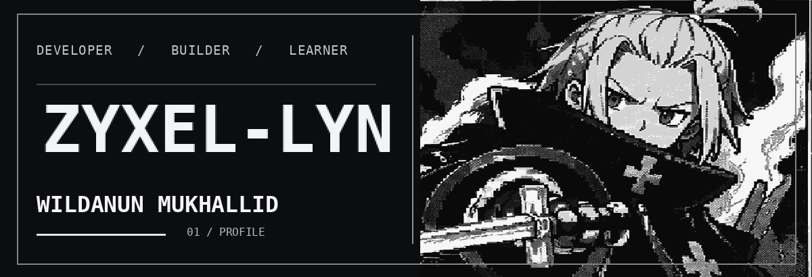
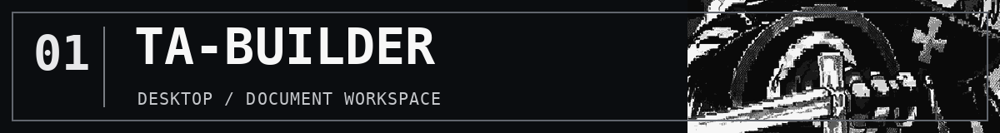
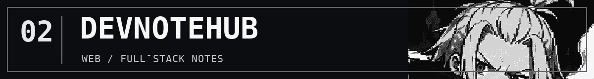
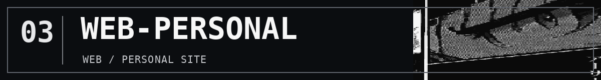

<!--
PROFILE / ZYXEL-LYN
Visual canon: APPROVED V2 Arthur Boyle Pixel Monochrome, reflow V3.
README is responsive and uses only GitHub-supported Markdown and images.
No fictitious repository metrics, CSS styling, or UI elements.
-->

  

<strong>Building software with intention.</strong> 
Ideas → Tools → Real Workflows.

---

### `01 / SELECTED WORK`

A Windows desktop workspace for structured academic writing, from project proposals to final reports. [Explore the project →](https://github.com/zyxel-lyn/TA-Builder)

A full-stack notes application covering authentication, search, tags, and personal organization. [Explore the project →](https://github.com/zyxel-lyn/devnotehub)

A small personal web space and early web development project. [Explore the project →](https://github.com/zyxel-lyn/web-personal)

---

### `02 / ABOUT`

I'm **Wildanun Mukhallid** (`zyxel-lyn`), a developer based in Indonesia. I build practical software and tools focused on useful workflows, clear interfaces, and maintainable implementation.

### `03 / CONTACT`

[GitHub](https://github.com/zyxel-lyn) · [Personal website](https://zyxel-lyn.github.io)

LESS NOISE. MORE WORK. / © ZYXEL-LYN
