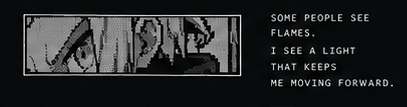

<!--
GitHub Profile / zyxel-lyn
IMMUTABLE VISUAL CANON: Arthur Boyle Pixel, Black/White Manga, approved V2.
This README preserves the hero, 3-up Selected Work, and 3-part footer.
Only native GitHub Markdown/HTML markup; GitHub interface chrome is not customizable.
No V3 stacked project art, gradients, animations, fake metrics, or custom CSS.
-->

  

### SELECTED WORK

<table>
  <tr>
    <td width="33.33%" valign="top"></td>
    <td width="33.33%" valign="top"></td>
    <td width="33.33%" valign="top"></td>
  </tr>
</table>

<table>
  <tr>
    <td width="40%" valign="top">
      <strong>ABOUT</strong> 
      I'm <strong>Wildanun Mukhallid</strong> (<code>zyxel-lyn</code>), a developer building practical software and useful tools.  
      Always learning. Always building.
    </td>
    <td width="24%" valign="top">
      <strong>GET IN TOUCH</strong>  
      <a href="https://github.com/zyxel-lyn">GitHub</a> 
      <a href="https://zyxel-lyn.github.io">Website</a>
    </td>
    <td width="36%" valign="top">
      
    </td>
  </tr>
</table>
