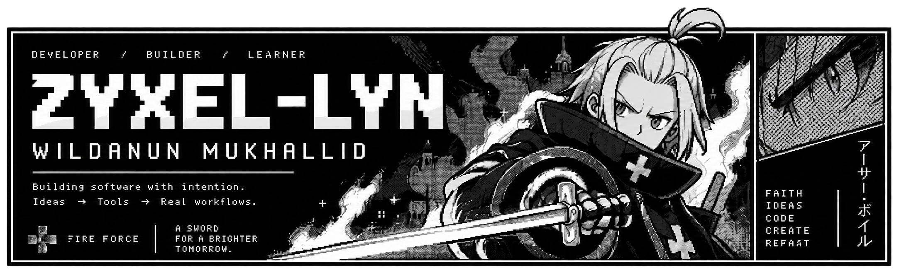
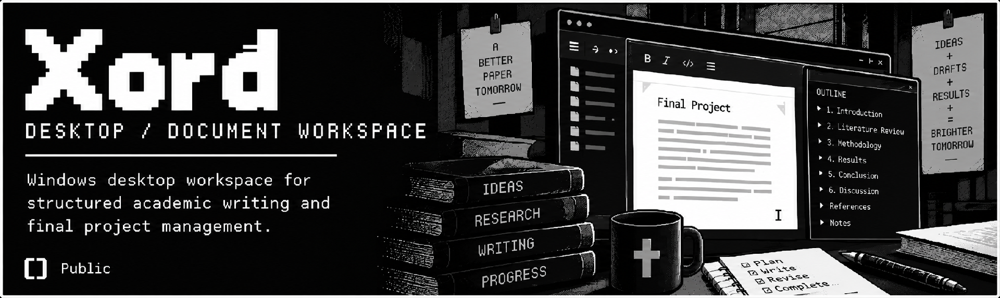
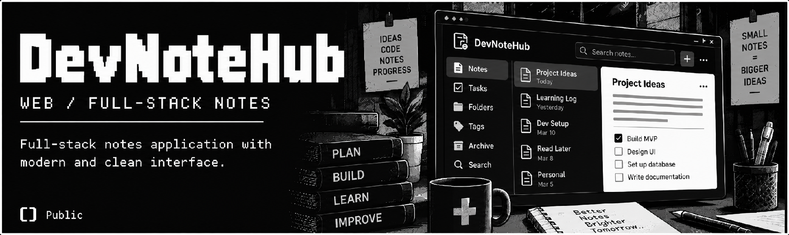
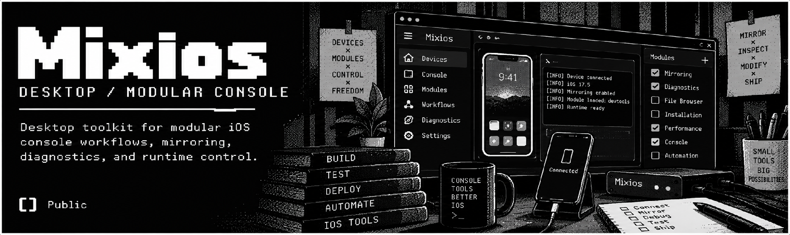
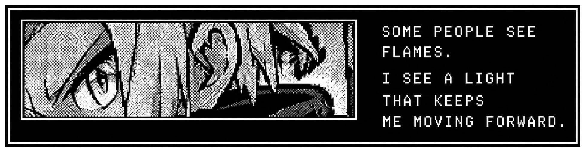

<!--
ZYXEL-LYN / GITHUB PROFILE
LOCKED: approved Arthur Boyle Pixel / black-white monochrome / manga V2.
Five individually generated production artworks; no screenshots cropped from the previous mockup.
Artwork is never CSS-cropped, repainted, recolored, smoothed, or reinterpreted.
GitHub account avatar and native interface are user-controlled and out of scope.
-->

  

### SELECTED WORK

<table>
  <tr>
    <td width="33.33%" valign="top">
      
    </td>
    <td width="33.33%" valign="top">
      
    </td>
    <td width="33.33%" valign="top">
      
    </td>
  </tr>
</table>

Mixios is a private development repository; its source is available only to authorized collaborators.

<table>
  <tr>
    <td width="40%" valign="top">
      <strong>- About</strong> 
      I'm <strong>Wildanun Mukhallid</strong> (<code>zyxel-lyn</code>), a developer who enjoys turning ideas into practical software.  
      Always learning. Always building.
    </td>
    <td width="24%" valign="top">
      <strong>- Get In Touch</strong>  
      <a href="https://github.com/zyxel-lyn">GitHub</a> 
      <a href="https://zyxel-lyn.github.io">Website</a>
    </td>
    <td width="36%" valign="top">
      <strong>- Arthur Boyle</strong> 
      
    </td>
  </tr>
</table>
